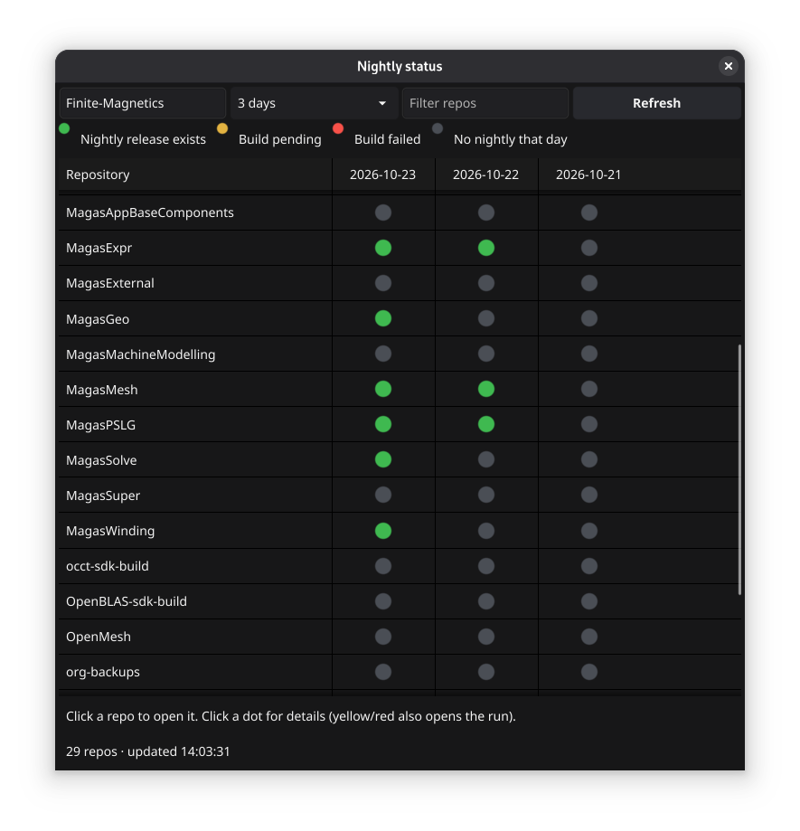

# gg-nightly

Nightly build status for every repo in a GitHub org, via the `gh` CLI.

## Requirements
- Go 1.26+ and the GitHub CLI signed in (`gh auth login`)
- Linux (Debian/Ubuntu): `sudo apt install gcc libgl1-mesa-dev xorg-dev`
- Linux (Fedora): `sudo dnf install gcc libXcursor-devel libXrandr-devel mesa-libGL-devel libXi-devel libXinerama-devel libXxf86vm-devel libxkbcommon-devel wayland-devel`
- macOS: `xcode-select --install`
- Windows: install MSYS2/MinGW-w64 gcc and put it on PATH

## Run
    go run .         # first build takes a minute or two

## Build a single binary
    go build -ldflags "-s -w" -o gg-nightly .                      # Linux, macOS
    go build -ldflags "-s -w -H windowsgui" -o gg-nightly.exe .    # Windows

## Using it
Type your org and press Enter. Rows fill in as data arrives; refreshes every 5 minutes.
Click a repo name to open it; click a dot to see details (yellow/red also opens the workflow run).
green = release with "nightly" in tag/name published that day; yellow = nightly run queued/in progress;
red = nightly run failed/cancelled/timed out; grey = nothing found.
Edit `nightlyRelease` / `nightlyRun` at the top of main.go to match your naming.
